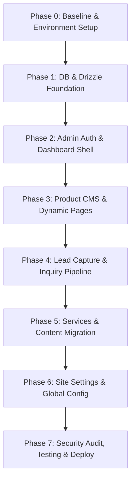

# SourceMonster CMS — Comprehensive Implementation Plan

> **Status: 100% Implemented & Verified (Phases 1–7 Complete)**  
> All 7 phases have been implemented, verified via automated test suites and production build, and committed to branch `cms-foundation`.

## Executive Summary & Alignment Check

This implementation plan translates [sourcemonster-cms-plan-v2.md](file:///d:/New%20folder/My-project/sourcemonster/docs/sourcemonster-cms-plan-v2.md) into concrete, phase-by-phase execution steps mapped specifically to the current state of the `sourcemonster` repository.

### Key Architectural Decisions
- **Unified Astro Monolith**: Zero extra microservices or Turborepo overhead. All public rendering, admin dashboard pages, and backend operations live within the existing Astro project.
- **Data & ORM**: PostgreSQL via `drizzle-orm` and `postgres` driver, schema migrations managed by `drizzle-kit`.
- **Validation**: Strict server-side validation using `zod`.
- **Authentication**: Stateful session auth with HTTP-only, secure, `SameSite=Lax` cookies, Argon2id/bcrypt password hashing, and token hashes stored in `admin_sessions`.
- **Storage**: Cloudflare R2 via `@aws-sdk/client-s3` with an automatic `STORAGE_DRIVER=local` fallback for offline/local development.
- **Email**: Maintain the existing Resend integration, but ensure inquiries are saved to PostgreSQL **before** triggering email dispatch.
- **Containerization**: Standard multi-stage `Dockerfile` + `docker-compose.yml` (dev) and `docker-compose.prod.yml` (prod).

---

## Codebase Assessment & Pre-requisite Findings

| Area | Current State in Repository | Implementation Impact |
| :--- | :--- | :--- |
| **Astro Framework** | Astro `^6.1.6`, SSR output with `@astrojs/node` standalone adapter | Fully compatible with Astro Actions and server middleware. |
| **Styling** | `@astrojs/tailwind` `^6.0.2`, `tailwindcss` `^3.4.17` | Admin UI can reuse the existing Tailwind configuration and styling system. |
| **Existing Actions** | `src/actions/index.ts` contains `sendEmail` (Resend) | Needs to be upgraded to persist to the `leads` table prior to calling Resend. |
| **Existing Content** | `src/content/`: `services`, `team`, `testimonials`, `workflow` | Currently no `products` JSON collection; initial seed for the 4 CodeCanyon products must be provided in `scripts/seeders/data/products.json`. |
| **Docker Support** | Docker Desktop 29.7.2 available | Local DB container (`postgres:16-alpine`) can be spun up immediately. |

---

## Phase-by-Phase Execution Roadmap



---

### Phase 0: Baseline Verification & Environment

**Goal**: Establish a clean working baseline, install base dependencies, and configure environment templates.

#### Tasks:
1. Verify package manager lockfile consistency (`package-lock.json` / `pnpm`).
2. Add `.env.example` containing configuration for:
   - `DATABASE_URL`
   - `SESSION_SECRET`
   - `RESEND_API_KEY` & `CONTACT_EMAIL`
   - `R2_ACCOUNT_ID`, `R2_ACCESS_KEY_ID`, `R2_SECRET_ACCESS_KEY`, `R2_BUCKET`, `R2_PUBLIC_BASE_URL`
   - `POSTGRES_USER`, `POSTGRES_PASSWORD`, `POSTGRES_DB`
   - `SEED_ADMIN_NAME`, `SEED_ADMIN_EMAIL`, `SEED_ADMIN_PASSWORD`
3. Verify production build passes cleanly (`npm run build` / `pnpm build`).

---

### Phase 1: Database & Project Foundation

**Goal**: Integrate PostgreSQL, Drizzle ORM, schema definitions, migration pipeline, and Docker Compose development setup.

#### Target File Structure:
```text
sourcemonster/
├── drizzle.config.ts
├── Dockerfile
├── docker-compose.yml
├── docker-compose.prod.yml
├── .dockerignore
├── scripts/
│   ├── docker-entrypoint.sh
│   └── seed.ts
├── src/
│   └── lib/
│       └── db/
│           ├── client.ts
│           ├── index.ts
│           └── schema/
│               ├── admin-users.ts
│               ├── admin-sessions.ts
│               ├── products.ts
│               ├── media.ts
│               └── leads.ts
```

#### Detailed Tasks:
1. **Dependencies**:
   - Install `drizzle-orm`, `postgres`, `zod`.
   - Install dev dependencies `drizzle-kit`, `tsx`, `@types/node`.
2. **Schema Definitions**:
   - `admin_users`: UUID, name, email (unique), password_hash, role, is_active, last_login_at, timestamps.
   - `admin_sessions`: ID (UUID/token), admin_user_id (FK), token_hash, expires_at, created_at, last_seen_at.
   - `products`: UUID, title, slug (unique), short_description, description, thumbnail_media_id (FK), codecanyon_url, demo_url, documentation_url, version, technologies (JSON/array), features (JSON/array), status ('draft' | 'published'), is_featured, sort_order, seo_title, seo_description, published_at, timestamps.
   - `media`: UUID, disk ('r2' | 'local'), object_key, original_name, mime_type, size_bytes, width, height, alt_text, created_at.
   - `product_media`: UUID, product_id (FK), media_id (FK), caption, sort_order, created_at.
   - `leads`: UUID, name, email, company, subject, message, product_id (FK nullable), service_id (nullable), budget, source_page, status ('new' | 'contacted' | 'qualified' | 'converted' | 'rejected'), admin_notes, timestamps.
3. **Database Client (`src/lib/db/client.ts`)**:
   - Singleton client using `postgres` driver with connection pooling.
4. **Drizzle Config & Migrations**:
   - Setup `drizzle.config.ts`.
   - Generate initial migration files under `drizzle/migrations/`.
   - Add scripts to `package.json`: `db:generate`, `db:migrate`, `db:studio`, `db:seed`.
5. **Docker Setup**:
   - Configure multi-stage `Dockerfile` with Node 22.
   - Configure `docker-compose.yml` exposing PostgreSQL (`127.0.0.1:5432:5432`) and the Astro app (`4321:4321`) with health check dependencies.
   - Configure `scripts/docker-entrypoint.sh` with conditional `RUN_MIGRATIONS`.

#### Acceptance Gate:
- [ ] `docker compose up -d db` starts healthy PostgreSQL.
- [ ] `db:migrate` creates all tables successfully from scratch.
- [ ] Astro dev server boots and connects without runtime errors.

---

### Phase 2: Admin Authentication & Dashboard Shell

**Goal**: Deliver secure server-side admin authentication and a responsive dashboard shell.

#### Target File Structure:
```text
src/
├── lib/
│   ├── auth/
│   │   ├── password.ts      # Argon2id / bcrypt hashing & verification
│   │   ├── session.ts       # Session creation, validation, revocation
│   │   └── cookies.ts       # Secure cookie abstraction
│   └── middleware/
│       └── auth.ts
├── middleware.ts
├── layouts/
│   └── AdminLayout.astro    # Sidebar, topbar, mobile drawer, logout
├── pages/
│   └── admin/
│       ├── login.astro      # Email/password form with rate limiting & error handling
│       ├── logout.ts        # Session revocation endpoint
│       └── index.astro      # Overview metrics & quick action cards
└── scripts/
    └── seeders/
        └── admin-user.ts    # CLI admin user seeder
```

#### Detailed Tasks:
1. **Password & Session Utilities**:
   - Implement `hashPassword(password)` and `verifyPassword(password, hash)` using `bcryptjs` / `@node-rs/argon2`.
   - Implement cryptographically random session token generation (`crypto.randomBytes`).
   - Store SHA-256 hash of tokens in `admin_sessions`.
2. **Admin User Seeder (`scripts/seeders/admin-user.ts`)**:
   - Reads `SEED_ADMIN_NAME`, `SEED_ADMIN_EMAIL`, `SEED_ADMIN_PASSWORD`.
   - Validates password length (>= 12 characters).
   - Idempotent upsert by email. Rejects placeholders in production.
3. **Astro Middleware (`src/middleware.ts`)**:
   - Intercept `/admin/*` routes (except `/admin/login`).
   - Inspect session cookie; validate token hash against `admin_sessions` and check `expires_at`.
   - Populate `Astro.locals.adminUser` or redirect unauthenticated requests to `/admin/login`.
4. **Admin UI Layout (`AdminLayout.astro`)**:
   - Dark/Modern dashboard theme matching SourceMonster's visual identity.
   - Collapsible sidebar with navigation: Dashboard, Products, Leads, Content, Settings.
   - Current user badge + one-click secure logout.

#### Acceptance Gate:
- [ ] `pnpm db:seed:admin` creates the admin user without printing plain passwords.
- [ ] Visiting `/admin` without a session redirects to `/admin/login`.
- [ ] Valid login creates session, sets `HttpOnly`, `SameSite=Lax`, `Secure` cookie, and opens dashboard.
- [ ] Logout invalidates the DB session and clears the cookie.

---

### Phase 3: Product CMS & Dynamic Public Pages

**Goal**: Enable administrators to manage the 4 CodeCanyon products and render dynamic product listings and detail pages.

#### Target File Structure:
```text
src/
├── lib/
│   ├── storage/
│   │   ├── index.ts         # Unified storage interface (upload, delete, getUrl)
│   │   ├── r2.ts            # S3/R2 client implementation
│   │   └── local.ts         # Local filesystem adapter for development
│   └── validation/
│       └── product.ts       # Zod schemas for product create/update
├── pages/
│   ├── products/
│   │   ├── index.astro      # Public product catalog
│   │   └── [slug].astro     # Dynamic product detail page
│   ├── admin/
│   │   └── products/
│   │       ├── index.astro  # Products list table (status, featured, sort, actions)
│   │       ├── new.astro    # Product creation form
│   │       └── [id]/
│   │           └── edit.astro # Product edit form & gallery manager
│   └── api/
│       └── admin/
│           ├── products.ts  # CRUD endpoints / Astro Actions
│           └── media.ts     # Media upload handler
└── scripts/
    └── seeders/
        ├── static-content.ts # Products & initial content seeder
        └── data/
            └── products.json # Default seed data for 4 CodeCanyon products
```

#### Detailed Tasks:
1. **Storage Module**:
   - Support `STORAGE_DRIVER=r2` and `STORAGE_DRIVER=local`.
   - Validate file type (PNG, JPG, WebP, SVG) and enforce 5MB limits.
   - Generate collision-proof object keys (`products/{uuid}-{timestamp}.{ext}`).
2. **Product CRUD & Media Linking**:
   - Admin form with tabbed or structured sections:
     - Basic Info: Title, slug (auto-slugifier helper), short description, full description.
     - Pricing & Links: CodeCanyon purchase URL, demo URL, documentation URL.
     - Technical Meta: Version, technologies tags, feature bullet points.
     - Publishing & SEO: Draft/Published toggle, Featured toggle, SEO Title, Meta Description.
     - Media Gallery: Main thumbnail selector + multi-image screenshot uploader.
3. **Public Product Pages**:
   - `/products`: Lists published products sorted by `sort_order`, displaying badge, tech stack, purchase CTA.
   - `/products/[slug]`: Hero banner, screenshot carousel/gallery, feature highlights, tech specs, distinct **Buy on CodeCanyon** button + **Request Customization** CTA button.
   - Return HTTP 404 for draft products accessed by anonymous visitors.
4. **Seed Initial 4 Products**:
   - Provide structured data for the 4 CodeCanyon products.
   - Run `pnpm db:seed:content` to populate products in draft/published state.

#### Acceptance Gate:
- [ ] Admin can create, edit, upload media, reorder, and publish products.
- [ ] `/products` queries and renders published products from PostgreSQL.
- [ ] `/products/[slug]` displays full details, screenshots, and correct external links.
- [ ] Seed script imports the 4 products idempotently.

---

### Phase 4: Lead Capture & Inquiry Pipeline

**Goal**: Capture leads through public inquiry forms with zero lead loss, storing them in PostgreSQL before attempting email notification via Resend.

#### Target File Structure:
```text
src/
├── actions/
│   └── index.ts             # Updated submitLead Astro Action
├── lib/
│   └── validation/
│       └── lead.ts          # Zod schema for lead submissions
└── pages/
    └── admin/
        └── leads/
            ├── index.astro  # Leads list (status badge, product attribution, date)
            └── [id].astro   # Lead detail view (message, private notes, status update)
```

#### Detailed Tasks:
1. **Lead Submission Action**:
   - Extract form data: Name, Email, Company, Related Product/Service, Budget, Message, Honeypot field.
   - Server-side Zod validation + spam filtering (reject if honeypot filled).
   - **Step 1**: Insert lead into `leads` table with status `new`.
   - **Step 2**: Attempt Resend email dispatch with sanitized/escaped HTML template.
   - If Resend throws or fails, log the error but return success to the user (lead safely persisted in DB).
2. **Customization CTAs on Product Detail Pages**:
   - Pre-fill `product_id` and product title in the inquiry modal/contact form when initiated from `/products/[slug]`.
3. **Admin Lead Management Interface**:
   - Filter leads by status (`new`, `contacted`, `qualified`, `converted`, `rejected`) and related product.
   - Lead detail page with full inquiry view, sender info, source attribution, and private `admin_notes` editor.

#### Acceptance Gate:
- [ ] Submitting contact/inquiry form creates row in `leads` table.
- [ ] If `RESEND_API_KEY` is invalid or unset, lead remains saved in DB without crashing.
- [ ] Admin can view leads, update status, and add private notes.

---

### Phase 5: Services, Portfolio & Testimonials Migration

**Goal**: Transition static JSON content collections (`services`, `testimonials`) into dynamic database-driven entities editable via the CMS.

#### Target File Structure:
```text
src/
├── lib/
│   └── db/
│       └── schema/
│           ├── services.ts
│           ├── portfolio.ts
│           └── testimonials.ts
└── pages/
    └── admin/
        ├── services/
        ├── portfolio/
        └── testimonials/
```

#### Detailed Tasks:
1. **Schema Migration**:
   - Create tables `services`, `portfolio_projects`, `testimonials`.
   - Run `db:generate` and `db:migrate`.
2. **Content Seeder Extension**:
   - Update `scripts/seeders/static-content.ts` to read existing `src/content/services/*.json` and `src/content/testimonials/*.json` and upsert into PostgreSQL.
3. **Admin Management Screens**:
   - CRUD screens for Services, Testimonials, and Portfolio items.
4. **Public Component Refactor**:
   - Update `Services.astro` and `Testimonials.astro` to query PostgreSQL when database is present, retaining static fallback if needed during transition.

---

### Phase 6: Site Settings & Editable Config

**Goal**: Manage global site configuration (social links, contact email, default SEO tags, header/footer notices) from the admin panel.

#### Detailed Tasks:
1. Schema for `site_settings` (key-value pairs with typed schema).
2. Admin Settings page (`/admin/settings`).
3. Global helper `getSiteSettings()` with in-memory caching to avoid redundant queries per request.

---

### Phase 7: Security Audit, Testing & Production Deployment

**Goal**: Harden the entire application, add automated regression tests, and prepare one-command deployment.

#### Detailed Tasks:
1. **Security Hardening**:
   - Rate limiting on `/admin/login` and `/actions/submitLead` (sliding window / IP bucket).
   - CSRF protection for form mutations.
   - Sanitize all rendered user inputs against XSS.
2. **Automated Testing Suite**:
   - Unit tests for validation schemas and password utilities (`vitest`).
   - Integration tests for auth flow and lead persistence.
   - Seeder idempotency tests (running seeder twice produces zero duplicates).
3. **Production Container & Deployment Guide**:
   - Validate `docker-compose.prod.yml` build and runtime execution.
   - Document reverse proxy configuration (Caddy/Nginx) with HTTPS.

---

## Commit Execution Plan

Each stage corresponds to a logical, reviewable Git commit:

```text
commit 1: chore: prepare astro app for cms (deps, docker compose, env config)
commit 2: feat: add postgres and drizzle schema (tables, client, migrations)
commit 3: feat: add admin authentication and seeder (sessions, middleware, login)
commit 4: feat: add admin dashboard layout and shell
commit 5: feat: add media storage driver (R2 + local disk fallback)
commit 6: feat: add product cms and admin crud
commit 7: feat: add static content seeder for products
commit 8: feat: render dynamic public product pages (/products, /products/[slug])
commit 9: feat: add lead capture pipeline with db persistence and resend notification
commit 10: feat: add admin lead management
commit 11: feat: migrate services and testimonials to database
commit 12: feat: add site settings management
commit 13: test: add cms security and integration tests
commit 14: docs: document cms deployment and operational runbooks
```

---

## Immediate Next Steps (Phase 1 Kick-off)

1. **Install Base Packages**:
   - Install `drizzle-orm`, `postgres`, `zod`, `drizzle-kit`, `tsx`, `bcryptjs` (or `@node-rs/argon2`).
2. **Initialize Environment & Docker**:
   - Create `.env.example` and `.dockerignore`.
   - Setup `docker-compose.yml` for local PostgreSQL.
3. **Create Database Schemas & Drizzle Client**:
   - Scaffold `src/lib/db/` and initial schemas (`admin-users`, `admin-sessions`, `products`, `media`, `leads`).
   - Run `db:generate` to produce the initial migration.

